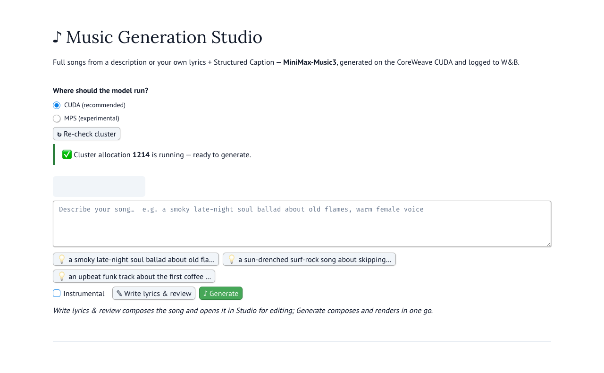

# Music Generation Studio — the marimo web app

A local web UI for generating full songs with **MiniMax-Music3**, modeled on the
official demo Space. You describe a song (or write lyrics + a Structured Caption
yourself), the app runs the model on a CoreWeave H100 over ssh, and the finished
track plays in your browser — with every run logged to Weights & Biases.



```bash
uv run marimo run app/app.py       # from the repo root → opens at http://localhost:2718
```

> ## ⚠️ The cluster must already be running
> **This app never starts or stops GPUs.** In CUDA mode it only *detects* a
> running `musicgen` Slurm allocation. You provision it before using the app,
> and you release it when you're done (step 3 below). If no allocation exists,
> the app shows a red warning and generation is disabled.

---

## Prerequisites

1. **SSH access to the CoreWeave training cluster.** The app drives everything
   through a passwordless ssh alias named `coreweave-login`. If you don't have
   cluster access, contact **Tara Madhyastha at CoreWeave**. Set up the alias in
   `~/.ssh/config`:

   ```
   Host coreweave-login
       HostName <your-cluster-login-hostname>
       User <your-cluster-username>
       IdentityFile ~/.ssh/<your-key>
   ```

   Verify with `ssh -o BatchMode=yes coreweave-login true` — it must succeed
   without any prompt.

2. **Credentials in `.env`** (repo root; copy `.env_example`): `WANDB_API_KEY`,
   `WANDB_ENTITY`, `WANDB_PROJECT` — songs and their configs are logged to this
   W&B project, and the same key authenticates the app's lyric/caption composer
   (Kimi K2.6 via W&B Inference) — plus `HF_TOKEN` for the model download.

3. **A local environment:** `uv sync` in the repo root (installs marimo and
   everything else).

## One-time cluster setup — move the code to the cluster

The generation script must live on the cluster in `~/music_gen_demo`. Mirror
the repo there and build its environment (re-run the `rsync` whenever scripts
or docs change):

```bash
# From the repo root, on your machine:
rsync -av --exclude .git --exclude .venv --exclude generated_audio --exclude demo_audio \
  ./ coreweave-login:music_gen_demo/

# Build the Python environment on the cluster (one time, and after dependency changes):
ssh coreweave-login "cd ~/music_gen_demo && export PATH=\$HOME/.local/bin:\$PATH && uv sync"
```

The first generation downloads ~57 GB of model weights into the cluster's
`~/.cache/huggingface` — check your quota; later runs reuse the cache.

## Every session: spin up the cluster, then the app

```bash
# 1. Provision one H100 (from the login node):
ssh coreweave-login
sbatch -p h100 --gres=gpu:1 --cpus-per-task=16 --mem=100G --job-name=musicgen --wrap "sleep infinity"
squeue -u $USER        # wait until the musicgen job shows state R (running)
exit

# 2. Launch the app locally:
uv run marimo run app/app.py
```

Open http://localhost:2718, and the execution panel should show
**"✅ Cluster allocation NNNN is running"** (click *↻ Re-check cluster* if you
provisioned after launching). When you're done for the day:

```bash
# 3. Release the GPU — the app will NOT do this for you:
ssh coreweave-login scancel <JOBID>
```

## Using the app

**Simple mode** — type what you want ("a smoky late-night soul ballad about old
flames, warm female voice"), or click an idea chip. Then either:

- **✎ Write lyrics & review** — Kimi K2.6 composes original lyrics and a full
  three-section caption and places them in the Studio tab for you to edit, or
- **♪ Generate** — composes and sends it straight to the GPU in one go.

Tick **Instrumental** for a song without vocals.

**Studio mode** — full control over both model inputs:

- **Lyrics** pane with quick-insert section tags (`[intro]`, `[verse]`,
  `[chorus]`, …). Tags must sit alone on their own line — words on a tag line
  are silently dropped by the model. A small assist box writes lyrics for you
  from a one-line description.
- **Three caption panes** (Global metadata / Vocal details / Arrangement) —
  the Structured Caption that controls how the song *sounds*. Format guide:
  [`../docs/minimax_music_prompt_guide.md`](../docs/minimax_music_prompt_guide.md);
  61 official worked examples:
  [`../docs/demo_prompt_examples.md`](../docs/demo_prompt_examples.md).
- **Preset chips** load known-good lyrics + caption pairs to start from.
- **Title** names the output file and the W&B caption.

**Settings** (collapsed panel) — max duration 5–360 s (it's a cap; the model
ends the song when the lyrics resolve), seed + randomize, flow-matching steps
(leave at 30).

## What to expect during generation

Generation takes **~2 minutes per 60 s of song, plus ~1.5 minutes of model
loading** per run. A spinner walks through the real phases — *uploading inputs →
launched on the H100 → loading model → composing with the language model →
decoding audio NN% → uploading to W&B* — **leave the tab open and don't
re-click Generate**; one generation runs at a time and duplicate clicks are
refused. When it finishes you get an audio player, a stats line (title, seed,
duration, wall time), a **link to the W&B run**, and a download button. The WAV
also lands in `generated_audio/MiniMax-Music3/<title>_s<seed>.wav`.

## MPS mode (experimental)

The device selector can target this Mac instead of the cluster (`MPS`): needs
≥32 GB unified memory, runs 5–20× slower than the H100, downloads the ~57 GB
model locally on first use, and the pipeline's operator coverage on Apple
Silicon is unverified — treat failures as expected. Details:
[`../docs/gpu_memory_tutorial.md`](../docs/gpu_memory_tutorial.md).

## Logs & troubleshooting

| Where | What |
|---|---|
| `logs/app_ui.log` | every UI event (session id, clicks, dispatches, backend phases) — `tail -f` this while testing |
| `logs/marimo_app.log` | the marimo server's own output (if launched via the background command) |
| `~/music_gen_demo/logs/app_*.log` (cluster) | the raw generation logs, one per run |

| Symptom | Cause / fix |
|---|---|
| Red "allocation is NOT running" callout | Provision the cluster (step 1 above), then *↻ Re-check cluster* |
| "Another generation is already in progress" | One song at a time — wait for the current run to finish |
| Generation failed + log tail shown | Read the tail; cluster environment issues are catalogued in [`../docs/cluster_environment.md`](../docs/cluster_environment.md) |
| Composer errors about `WANDB_API_KEY` | Fill in `.env` (Prerequisites §2) |

## Files in this directory

```
app.py           the marimo app (UI + reactive wiring)
backend.py       execution: ssh/srun cluster runs, local MPS runs, logging, one-run-at-a-time lock
compose.py       Kimi K2.6 composer (lyrics + captions), shared with scripts/generate_lyrics.py
screenshots/     images used by this README
```
